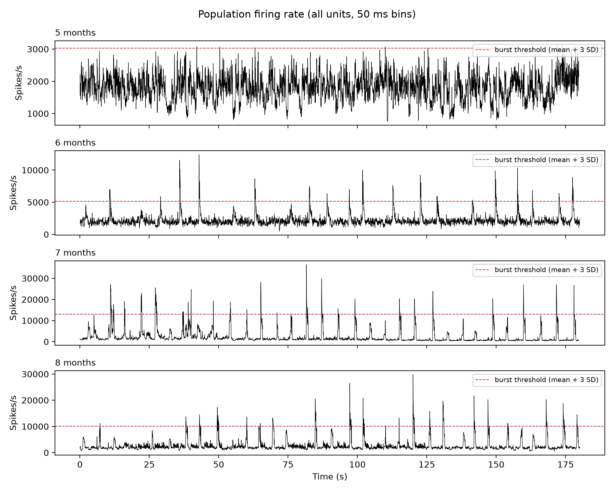
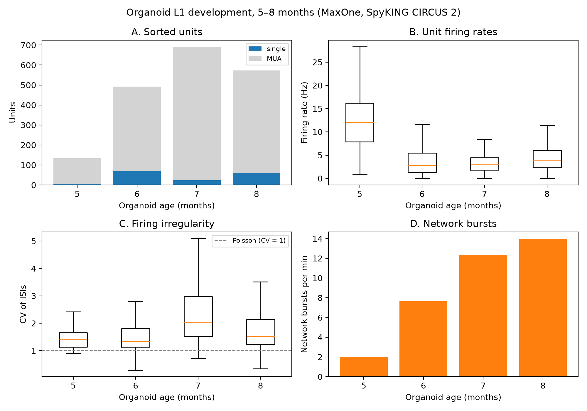
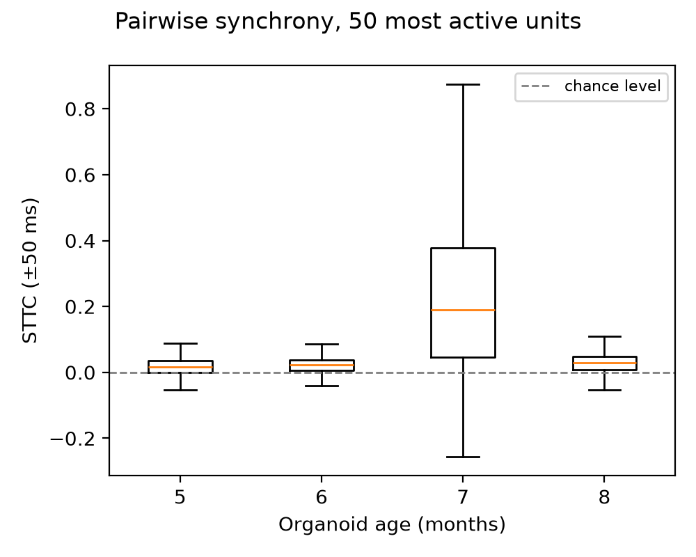

# hdmea-organoid-pipeline
From raw MaxWell HD-MEA recordings to network analysis: spike sorting, firing, network bursts and synchrony in a developing human brain organoid.

**Status:** work in progress. Pipeline validated on a MaxOne test file and applied to an organoid development series (5–8 months).

## Results

Organoid L1 (Sharf et al., 2022) recorded on a MaxOne HD-MEA (1,020 electrodes, 20 kHz, 3 min) at 5, 6, 7 and 8 months, spike sorted with SpyKING CIRCUS 2 on a laptop CPU.

- **Network bursts emerge with maturation.** At 5 months activity is irregular with no clear network events. From 6 months on, synchronised bursts appear every few seconds and become more frequent (≈8 → 14 per min from 6 to 8 months).
- **Population activity increases** by about 50% from 5 to 8 months (1,810 → 2,712 spikes/s).
- **Firing is bursty at all ages:** the median CV of inter-spike intervals is 1.4–2.0, above the Poisson value of 1.
- **Pairwise synchrony increases with maturation** (median STTC 0.01, 0.03, 0.16 and 0.08 at 5–8 months; ±50 ms, all unit pairs), peaking at 7 months, when bursts are sharpest relative to baseline.

**Sorting quality.** Few units pass strict single-unit criteria (SNR ≥ 5, < 1% ISIs under 1.5 ms), since organoid spikes are small (median SNR ~2–3). Network-level measures therefore use all units (single + multi-unit activity). Unit counts and per-unit rates at 5 months are likely affected by merged units.

## Pipeline

| Notebook | Content |
|---|---|
| `01_load_and_inspect_maxwell.ipynb` | Load a MaxOne file, convert ADC counts to µV, band-pass filter (300–6000 Hz), threshold detection (−5σ) |
| `02_spike_sorting.ipynb` | Sort with SpyKING CIRCUS 2, remove duplicate spikes, label units single vs MUA |
| `03_organoid_development.ipynb` | Sort the 4 development recordings, quality check, firing rates, CV, population rate, network bursts and STTC |
| `src/spike_metrics.py` | Reusable functions: CV, population rate, network bursts, STTC |

Notes: MaxWell files need the HDF5 decompression plugin (`HDF5_PLUGIN_PATH`). The organoid files contain 1,028 data rows for 1,020 electrodes, so channels are selected explicitly before sorting.

## Data

Raw data is **not** stored in this repo (see `.gitignore`).

| Data | Source | Size | Use |
|---|---|---|---|
| `maxone_record_000011.raw.h5` | GIN `NeuralEnsemble/ephy_testing_data`, `maxwell/MaxOne_data/Record/000011/data.raw.h5` | 18 MB | Test file → `data/raw/` |
| `Development_2953_{5,6,7,8}month.raw.h5` | Dryad, doi:10.25349/D9031Z (Sharf et al., 2022, *Nat. Commun.* 13:4403) | ~1.8 GB each | Organoid development series; download manually and set `data_dir` in notebook 03 |

Test file download:

    curl -L -o data/raw/maxone_record_000011.raw.h5 https://gin.g-node.org/NeuralEnsemble/ephy_testing_data/raw/master/maxwell/MaxOne_data/Record/000011/data.raw.h5

## Setup

    conda create -n hdmea python=3.11 -y
    conda activate hdmea
    pip install -r requirements.txt

## Future work

- Re-sort the 5-month recording and compare unit yield with the authors' Kilosort2 results
- Reduce duplicate spikes by tuning template matching
- Diazepam dose-response recordings from the same dataset

## References

- Sharf T, van der Molen T, et al. (2022). Functional neuronal circuitry and oscillatory dynamics in human brain organoids. *Nature Communications* 13:4403. doi:10.1038/s41467-022-32115-4
- Data: Dryad, doi:10.25349/D9031Z (released under CC0)
- Test file: NeuralEnsemble `ephy_testing_data` (GIN)
- Buccino AP, et al. (2020). SpikeInterface, a unified framework for spike sorting. *eLife* 9:e61834
- Cutts CS, Eglen SJ (2014). Detecting pairwise correlations in spike trains: an objective comparison of methods and application to the study of retinal waves. *J Neurosci* 34:14288–14303 (STTC)